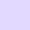

# colours

A dark colour pallette that attempts to keep the colour ratio to at least a WCAG 2.1[^1] AA rating of 4.5:1. For the colour ratios, the calculation is against the base Onyx colour. Given the intent of the ratio, colours with a ratio equal to, or greater than, the aformentioned AA rating can be used against the base.

| swatch                                             | name       | rgb           | hex      | hsl              | ratio to base |
|:--------------------------------------------------:|:-----------|---------------|----------|------------------|--------------:|
|  | Onyx       | `27 22 22     ` | `1B1616` | `0, 10%, 10%     ` |           1:1 |
|  | Jet        | `44 43 43     ` | `2C2B2B` | `0, 1%, 17%      ` |          1:27 |
|  | Lead       | `57 58 68     ` | `393A44` | `235, 9%, 25%    ` |          1:59 |
|  | Powder     | `75 76 85     ` | `4B4C55` | `234, 6%, 31%    ` |        2.10:1 |
|  | Slate      | `106 107 114  ` | `6A6B72` | `233, 4%, 43%    ` |        3.38:1 |
|  | Steel      | `153 153 160  ` | `9999A0` | `240, 4%, 61%    ` |    6.32:1[^2] |
|  | Ghost      | `219 219 221  ` | `DBDBDD` | `240, 3%, 86%    ` |       12.95:1 |
|  | Mist       | `253 250 252  ` | `FDFAFC` | `320, 43%, 99%   ` |       17.27:1 |
|  | Watermelon | `250 105 118  ` | `FA6976` | `355, 94%, 70%   ` |        6.26:1 |
|  | Tangerine  | `255 147 122  ` | `FF937A` | `11, 100%, 74%   ` |        8.27:1 |
|  | Olive      | `148 191 85   ` | `94BF55` | `84, 45%, 54%    ` |        8.39:1 |
|  | Kiwi       | `179 230 103  ` | `B3E667` | `84, 72%, 65%    ` |        12.3:1 |
|  | Mango      | `255 198 109  ` | `FFC66D` | `37, 100%, 71%   ` |       11.55:1 |
|  | Peach      | `255 219 161  ` | `FFDBA1` | `37, 100%, 82%   ` |       13.55:1 |
|  | Lake       | `84 162 204   ` | `54A2CC` | `201, 54%, 56%   ` |        6.32:1 |
|  | Ruddy      | `105 202 255  ` | `69CAFF` | `201, 100%, 71%  ` |        9.79:1 |
|  | Lilac      | `192 171 255  ` | `C0ABFF` | `255, 100%, 84%  ` |        8.96:1 |
|  | Lavender   | `226 217 255  ` | `E2D9FF` | `254, 100%, 93%  ` |        13.3:1 |
|  | Seafoam    | `102 204 170  ` | `66CCAA` | `160, 50%, 60%   ` |        9.19:1 |
|  | Aqua       | `127 255 212  ` | `7FFFD4` | `160, 100%, 75%  ` |       14.62.1 |

[^1]: 1.4.3 Contrast (Minimum), [“How to Meet WCAG (Quickref Reference)”](https://www.w3.org/WAI/WCAG22/quickref/?versions=2.1#contrast-minimum)
[^2]: From Steel on down we have the colours with acceptable contrast against the base Onyx colour for text
